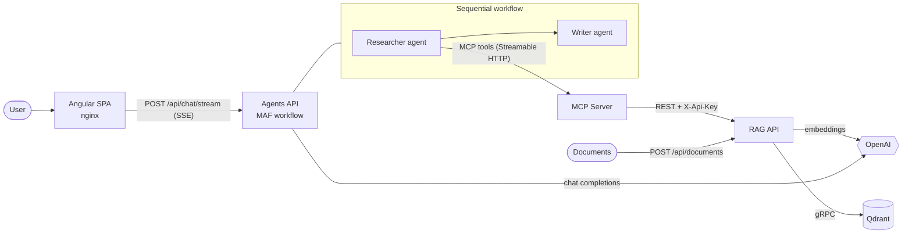

# MAF Knowledge Platform

A production-ready reference implementation of an **agentic RAG system** on .NET 10, built from four
independently deployable projects:

| Project | Path | What it does |
|---------|------|--------------|
| **RAG pipeline** | `src/Maf.Rag.Core`, `src/Maf.Rag.Api` | Parses documents (md, txt, html, pdf, …), chunks them, embeds with OpenAI and stores vectors in **Qdrant**. Exposes ingestion + semantic search over REST. |
| **MCP server** | `src/Maf.Mcp.Server` | A [Model Context Protocol](https://modelcontextprotocol.io) server (Streamable HTTP) that exposes the knowledge base as tools: `search_knowledge_base`, `list_knowledge_base_documents`. Works with any MCP client. |
| **Multi-agent workflow** | `src/Maf.Agents.Api` | A [Microsoft Agent Framework](https://github.com/microsoft/agent-framework) sequential workflow: a **Researcher** agent uses the MCP tools to gather evidence, a **Writer** agent composes a cited answer. Streams progress via Server-Sent Events. |
| **Frontend** | `frontend/maf-web` | Angular 22 chat app that calls the agents and shows tool calls, agent steps and the final answer live. |

Shared plumbing lives in `src/Maf.ServiceDefaults` (OpenTelemetry, health checks, HTTP resilience,
API-key auth).

## Architecture



**Request flow:** the SPA posts the question and conversation history → the Agents API builds a
Researcher → Writer workflow → the Researcher calls `search_knowledge_base` (possibly several times)
on the MCP server → the MCP server queries the RAG API → the RAG API embeds the query and runs a
cosine search in Qdrant → results flow back, the Researcher writes notes, the Writer streams a
Markdown answer with `(source: file)` citations.

## Quick start (Docker)

Prerequisites: Docker, an OpenAI API key.

```bash
cp .env.example .env            # set OPENAI_API_KEY, RAG_API_KEY, MCP_API_KEY
docker compose up -d --build

# index the sample documents
set -a; . ./.env; set +a
./scripts/ingest.sh samples/docs          # PowerShell: ./scripts/ingest.ps1
```

| URL | What |
|-----|------|
| http://localhost:4200 | Chat UI |
| http://localhost:18888 | Aspire dashboard – traces (incl. `gen_ai` spans for every LLM/tool call), metrics, logs |
| http://localhost:6333/dashboard | Qdrant UI |
| http://localhost:5101 | RAG API (ingestion) |
| http://localhost:5102/mcp | MCP endpoint |

Try: *"How many days a week can I work remotely, and what are the core hours?"*

## Local development

Prerequisites: .NET SDK 10, Node 24, Docker (for Qdrant).

```bash
docker run -d -p 6333:6333 -p 6334:6334 qdrant/qdrant:v1.19.2

# secrets via user-secrets (never commit keys)
dotnet user-secrets --project src/Maf.Rag.Api    set OpenAI:ApiKey sk-...
dotnet user-secrets --project src/Maf.Agents.Api set OpenAI:ApiKey sk-...

dotnet run --project src/Maf.Rag.Api      # http://localhost:5101
dotnet run --project src/Maf.Mcp.Server   # http://localhost:5102
dotnet run --project src/Maf.Agents.Api   # http://localhost:5103

cd frontend/maf-web && npm ci && npm start   # http://localhost:4200
```

With no `Security:ApiKey` configured, API-key checks are disabled — convenient locally, never in production.

### Tests

```bash
dotnet test Maf.slnx                         # 30 tests: chunking, ingestion, RAG API, MCP, agent workflow + SSE
cd frontend/maf-web && npx ng test --watch=false
```

The agent tests run the **real** MAF workflow against a scripted `IChatClient`, verifying tool
invocation, agent hand-over, history handling and the SSE wire format without calling OpenAI.

## Configuration

All settings follow standard ASP.NET Core configuration (appsettings → env vars with `__` → user-secrets).

| Service | Key | Default | Notes |
|---------|-----|---------|-------|
| RAG API | `OpenAI:ApiKey` | — | required |
| | `OpenAI:EmbeddingModel` | `text-embedding-3-small` | |
| | `OpenAI:Endpoint` | — | optional, for OpenAI-compatible endpoints |
| | `Qdrant:Host` / `Port` / `UseTls` / `ApiKey` | `localhost` / `6334` / `false` | gRPC port |
| | `Rag:CollectionName` | `knowledge_base` | |
| | `Rag:EmbeddingDimensions` | `1536` | must match the model |
| | `Rag:ChunkSize` / `ChunkOverlap` | `1200` / `200` | characters |
| | `Rag:DefaultTopK` / `DefaultMinScore` | `5` / `0.25` | |
| | `Rag:MaxUploadBytes` | 25 MB | |
| | `Security:ApiKey` | — | required header `X-Api-Key` on `/api/*` |
| MCP server | `RagApi:BaseUrl` / `RagApi:ApiKey` | `http://localhost:5101` | |
| | `Security:ApiKey` | — | required header `X-Api-Key` on `/mcp` |
| Agents API | `OpenAI:ApiKey` / `OpenAI:ChatModel` | — / `gpt-5-mini` | |
| | `Mcp:Endpoint` / `Mcp:ApiKey` | `http://localhost:5102/mcp` | |
| | `Mcp:ToolCacheMinutes` | `5` | MCP tool list cache |
| | `Agents:RequestTimeoutSeconds` | `180` | per chat request |
| | `Agents:MaxConcurrentRuns` | `20` | global concurrency cap (protects LLM quota) |
| | `Agents:MaxHistoryMessages` | `20` | |
| | `Cors:AllowedOrigins` | `http://localhost:4200` | only needed when not served via nginx |
| All | `OTEL_EXPORTER_OTLP_ENDPOINT` | — | enables OTLP export of traces/metrics/logs |

## API reference

OpenAPI documents are served at `/openapi/v1.json` in Development.

### RAG API (`X-Api-Key` required)

| Method | Path | Body |
|--------|------|------|
| `POST` | `/api/documents` | multipart: `file`, optional `title`, optional `metadata` (JSON object of strings) |
| `POST` | `/api/documents/text` | `{ "source", "content", "title?", "documentId?", "metadata?" }` |
| `GET` | `/api/documents?limit=100` | — |
| `DELETE` | `/api/documents/{documentId}` | — |
| `POST` | `/api/search` | `{ "query", "topK?", "minScore?", "source?", "documentId?" }` |

Re-uploading a file with the same name **replaces** it: point IDs are deterministic per
(document, chunk), new chunks are upserted in place, and leftover chunks are deleted afterwards, so the
document stays searchable during re-ingestion.

### Agents API

| Method | Path | Body | Response |
|--------|------|------|----------|
| `POST` | `/api/chat/stream` | `{ "message", "history": [{ "role": "user"\|"assistant", "content" }] }` | `text/event-stream` |
| `POST` | `/api/chat` | same | `{ "answer", "steps": [{ "agent", "output", "toolCalls" }] }` |

SSE events (`event:` name = `type`): `agent_started`, `delta`, `tool_call`, `tool_result`, `final`, `error`.

```bash
curl -N localhost:5103/api/chat/stream -H 'Content-Type: application/json' \
  -d '{"message":"What is the meal allowance when travelling?"}'
```

### Using the MCP server from other clients

The MCP server is a standalone product: point VS Code, Claude Desktop/Code, or any MCP client at it.

```jsonc
// .vscode/mcp.json
{
  "servers": {
    "knowledge-base": {
      "type": "http",
      "url": "http://localhost:5102/mcp",
      "headers": { "X-Api-Key": "${input:mcpKey}" }
    }
  },
  "inputs": [{ "id": "mcpKey", "type": "promptString", "password": true, "description": "MCP API key" }]
}
```

## Production readiness

**Included**

- **Observability:** OpenTelemetry traces, metrics and logs everywhere, including `gen_ai.*` spans for each
  LLM call and tool invocation (Microsoft.Extensions.AI instrumentation) and custom `Maf.Rag` metrics
  (`maf.rag.documents_ingested`, `maf.rag.chunks_ingested`, `maf.rag.search_hits`).
- **Health probes:** `/health/live` (process) and `/health/ready` (Qdrant / MCP reachability) for Kubernetes.
- **Resilience:** standard HTTP resilience (retry with jitter, circuit breaker, timeouts) on every outbound
  call; OpenAI SDK retries; Qdrant collection bootstrap retries with backoff until the DB is up.
- **Security:** constant-time API-key checks between services; non-root containers; secrets only via
  env/user-secrets; nginx security headers + CSP; model output rendered through DOMPurify; ports bound to
  `127.0.0.1` in compose except the UI.
- **Abuse & cost control:** per-IP rate limiting, global concurrency cap on agent runs, request timeouts,
  validated request sizes (.NET 10 minimal-API validation), upload size limits.
- **Scalability:** all services are stateless — the MCP server runs in MCP *stateless* mode and
  conversation history travels with each request — so every tier scales horizontally.
- **Correct streaming:** failures after the SSE response has started are converted into a terminal
  `error` event; client disconnects cancel the agent run.
- **Quality gates:** warnings-as-errors with .NET analyzers, central package management, CI for build, tests,
  formatting and container images.

**Recommended next steps for your environment**

- Put the Agents API behind your identity provider (e.g. Entra ID / OIDC with JWT bearer) and replace the
  shared API keys with workload identity / mTLS between services.
- Store secrets in a vault (Azure Key Vault, AWS Secrets Manager, Kubernetes secrets + CSI driver).
- Run Qdrant as a replicated cluster (or Qdrant Cloud) with snapshots/backups and API-key auth enabled.
- Move large-file ingestion to a background queue (e.g. Azure Service Bus / RabbitMQ) if uploads exceed
  a few MB or need OCR.
- Add evaluation (e.g. `Microsoft.Extensions.AI.Evaluation`) for groundedness/relevance on a golden question set.

## Repository layout

```
├── src/
│   ├── Maf.ServiceDefaults/   # OpenTelemetry, health, resilience, API-key auth
│   ├── Maf.Rag.Core/          # parsing, chunking, embeddings, Qdrant vector store
│   ├── Maf.Rag.Api/           # ingestion + search REST API
│   ├── Maf.Mcp.Server/        # MCP server exposing knowledge-base tools
│   └── Maf.Agents.Api/        # MAF multi-agent workflow + SSE chat API
├── tests/                     # xUnit tests per service
├── frontend/maf-web/          # Angular chat UI (+ nginx.conf, Dockerfile)
├── deploy/dotnet.Dockerfile   # shared multi-stage image for .NET services
├── samples/docs/              # sample knowledge-base documents
├── scripts/ingest.{sh,ps1}    # bulk ingestion helpers
└── docker-compose.yml
```
